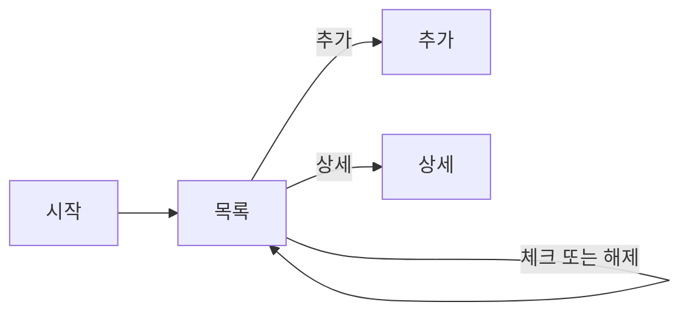

# DEV-25 화면정의서 — 습관 목록

| 필드 | 값 |
|---|---|
| 상태 | draft |
| 코드 | DEV-25 |
| 마지막 갱신 | 2026-10-13 |
| 범위 | 앱을 열면 나오는 습관 목록의 진입, 요소, 상태 |
| 비범위 | 문구 전문(DEV-28), 체크 인수(DEV-22), 상세 화면의 필드 |
| 관련 문서 | 아래 관련 문서 표 |

## ＊ 화면 목적
습관 목록에서 오늘 체크를 한다.

## ＊ 진입·이탈
| 구분 | 경로 |
|---|---|
| 진입 | 앱 시작 시 이 화면 |
| 이탈 | 습관 상세 또는 습관 추가 |

## ＊ 주요 UI 요소
| 요소 | 동작 |
|---|---|
| 습관 행. DEV-35 | 오늘을 체크하거나 해제한다(DEV-22) |
| 습관 행 문구 | DEV-28 |
| 추가 버튼 | 습관 추가 화면으로 간다 |
| 주간 요약 | 노출은 `HC-FLAG` (`_examples/DEV-52-기능플래그-주간요약.HabitCheck.md`). 화면 전환은 미결 1 |

## ＊ 상태
| 상태 | 사용자에게 보이는 것 |
|---|---|
| 로딩 | 로컬 DB를 처음 여는 동안의 스켈레톤 |
| 빈 화면 | DEV-28 |
| 에러 | DEV-28 미결 1 |

## ○ 접근
| 요소 | 읽는 이름 | 확인 |
|---|---|---|
| 습관 행 | DEV-28 | 그 키 밖의 이름을 체크 컨트롤에 만들지 않는다 |
| 추가 버튼 | 읽는 이름 키는 DEV-28에 없다 | 키가 생기기 전에는 버튼 문구를 짓지 않는다 |

## ○ 흐름 (Mermaid)

## 시안
| 종류 | 링크 |
|---|---|
| 시안 | 시안 파일이 없다 |

## ○ 관련 문서
| 코드 | 경로 |
|---|---|
| DEV-20 | `DEV-20-요구사항.HabitCheck.md` |
| DEV-22 | `DEV-22-오늘체크.HabitCheck.md` |
| DEV-28 | `DEV-28-UI문구-목록.HabitCheck.md` |
| DEV-52 | `DEV-52-기능플래그-주간요약.HabitCheck.md` |
| DEV-85 | `DEV-85-play-내부만.HabitCheck.md` |
| DEV-40 | `DEV-40-없음-v1.HabitCheck.md` |
| DEV-35 | `DEV-35-습관체크인.HabitCheck.md` |
## 미결
| ID | 내용 |
|---|---|
| 1 | 없는 사실: 주간 요약의 화면 전환이 없다. 다음 행동: 자리를 정하면 주요 UI 요소 행을 고친다. 그 전에 자리를 짓지 않는다. |
