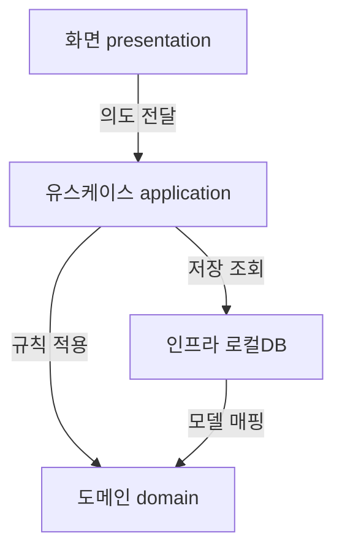
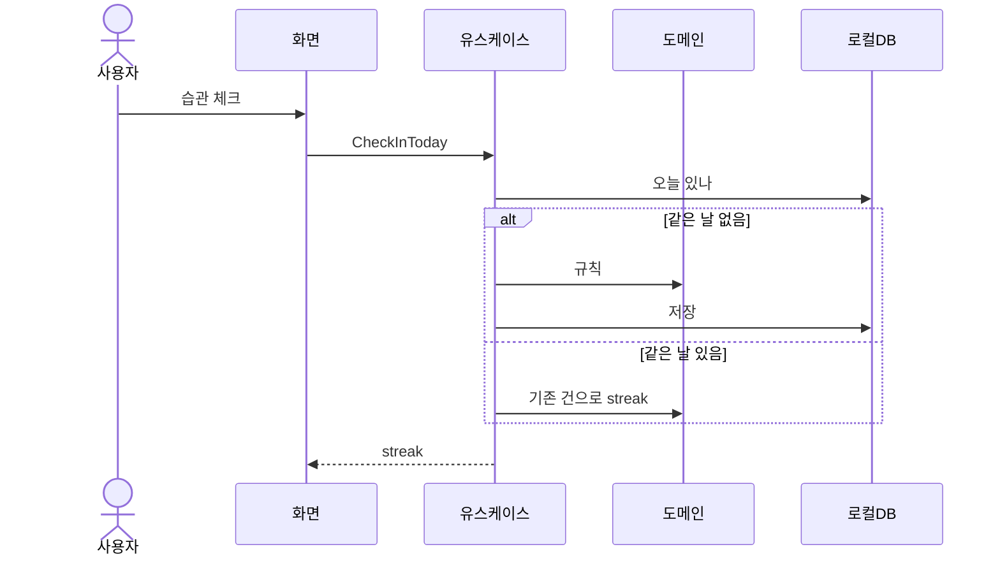

# DEV-30 구조명세서 — HabitCheck

| 필드 | 값 |
|---|---|
| 상태 | draft |
| 코드 | DEV-30 |
| 마지막 갱신 | 2026-10-13 |
| 범위 | 레이어, 의존 방향, 로컬 데이터 위치, 오늘 체크의 호출 순서 |
| 비범위 | HTTP(DEV-40), 화면 문구(DEV-28), 스토어(DEV-85), DB 제품 선정 근거(DEV-50) |
| 관련 문서 | 아래 관련 문서 표 |

## ＊ 한 줄 구조 요약
화면은 유스케이스만 호출한다. 유스케이스는 도메인과 로컬 저장을 부르고, 저장 계층은 행을 도메인 모델로 매핑해 되돌린다.

## ＊ 모듈/레이어
| 모듈 | 책임 | 비고 |
|---|---|---|
| 화면 presentation | 목록·상세·체크 UI | 유스케이스만 호출 |
| 유스케이스 application | 추가·오늘 체크·streak 조회 | 한 의도당 한 유스케이스 |
| 도메인 domain | Habit·CheckIn, streak, 날짜 경계 | streak 정의는 실행 흐름 절의 HC-STREAK 문장이다. 이 칸은 그 문장을 다시 쓰지 않는다 |
| 인프라 infrastructure | 로컬 DB, 마이그레이션, 시계 | 저장·조회와 모델 매핑 |

## ＊ 구조도 (Mermaid)

## ○ C4 수준
| 수준 | 이 문서에서 | 그리지 않는 것 |
|---|---|---|
| 컴포넌트 | 필수 구조도는 한 앱 안의 화면, 유스케이스, 도메인, 인프라다 | 시스템 맥락의 사용자와 바깥 시스템은 DEV-10. 코드 수준의 클래스는 그리지 않는다 |

## ＊ 의존 규칙
| 방향 | 허용? | 설명 |
|---|---|---|
| 화면 → 유스케이스 | 허용 | 화면은 유스케이스만 호출 |
| 유스케이스 → 도메인 | 허용 | 날짜·streak 규칙은 도메인에 둔다 |
| 유스케이스 → 인프라 | 허용 | 저장과 조회. DEV-32 |
| 인프라 → 도메인 | 허용 | 저장된 행을 도메인 모델로 매핑 |
| 화면 → DB | 금지 | 화면이 DB를 직접 열지 않는다 |
| 도메인 → Flutter UI | 금지 | 도메인이 위젯·플러그인을 부르지 않는다 |

## ＊ 건드리기 위험 구역
| 모듈 | 이유 | 경로(□) |
|---|---|---|
| 도메인 streak·날짜 | 날짜 경계는 `HC-MIDNIGHT` (`_examples/DEV-70-오늘체크.HabitCheck.md`). 이 칸은 그 문장을 다시 쓰지 않는다 | 없는 사실: 파일 경로를 정하지 않았다. 다음 행동: 파일이 생기면 이 칸에 경로만 적는다. 그 전에 경로를 짓지 않는다 |
| 인프라 마이그레이션 | 실패하면 데이터를 잃는다. DEV-10 | 없는 사실: 폴더 이름을 정하지 않았다. 다음 행동: DEV-50이 닫힌 뒤에 그 기록의 경로만 이 칸에 적는다. 그 전에 폴더 이름을 짓지 않는다 |

## ○ 핵심 실행 흐름

streak는 한 습관의 CheckIn.localDate만 센다. 가장 최근 체크인 날짜에서 하루씩 과거로 이어진 개수이고, 하루가 비면 그 앞에서 끊긴다. weeklyGoal은 세지 않는다. 오늘을 해제하면 그 localDate가 빠진다. 남은 체크인이 없으면 0이다. 남아 있으면 가장 최근 남은 날짜에서 다시 센다. 빈 날 없이 이어진 7일 뒤 오늘만 해제하면 가장 최근 날이 어제이므로 6이다. 날짜를 자르는 시각은 `HC-MIDNIGHT` (`_examples/DEV-70-오늘체크.HabitCheck.md`)이다.

| 단계 | 행위자 | 행동 |
|---|---|---|
| 1 | 사용자 | 목록에서 오늘을 체크한다 |
| 2 | 화면 | CheckInToday를 유스케이스에 넘긴다. DEV-35 |
| 3 | 유스케이스 | 오늘 행이 없으면 체크인을 하나 만든다. DEV-35 |
| 4 | 유스케이스 | DEV-22 AC-2. 3과 4는 순서가 아니라 갈림이다 |
| 5 | 유스케이스 | streak를 화면에 돌려준다 |
| 6 | 사용자 | 목록에서 오늘을 해제한다 |

아래 시퀀스는 오늘 체크의 갈림만 그린다. 해제는 위 표 6단계와 DEV-22 AC-3을 본다.

## ○ 데이터 위치
| 데이터 | 위치 |
|---|---|
| 습관·체크인 | DEV-10, DEV-35 |
| 화면 상태 | 메모리 |
| 계정·원격 복사본 | DEV-10 |

## ○ 관련 문서
| 코드 | 경로 |
|---|---|
| DEV-10 | `DEV-10-개요서.HabitCheck.md` |
| DEV-32 | `DEV-32-모듈-application.HabitCheck.md` |
| DEV-35 | `DEV-35-습관체크인.HabitCheck.md` |
| DEV-50 | `DEV-50-로컬DB-drift.HabitCheck.md` |
| DEV-65 | `DEV-65-테스트명세서.HabitCheck.md` |
| DEV-40 | `DEV-40-없음-v1.HabitCheck.md` |
| DEV-28 | `DEV-28-UI문구-목록.HabitCheck.md` |
| DEV-85 | `DEV-85-play-내부만.HabitCheck.md` |
| DEV-22 | `DEV-22-오늘체크.HabitCheck.md` |
| DEV-25 | `DEV-25-화면정의서-목록.HabitCheck.md` |
| DEV-70 | `DEV-70-오늘체크.HabitCheck.md` |
## 미결
| ID | 내용 |
|---|---|
| 1 | 없는 사실: 로컬 DB 구현체의 결정 상태는 `HC-DRIFT-STATE` (`_examples/DEV-50-로컬DB-drift.HabitCheck.md`). 다음 행동: 인프라 행의 비고에 제품명을 적을지는 그 기록을 따른다. |
| 2 | 없는 사실: 로컬 DB 오류를 유스케이스가 어떤 값으로 돌려주고 DEV-25 에러 상태가 어떻게 받는지는 아직 없다. 다음 행동: 정하면 흐름 표에 실패 단계를 추가한다. |
