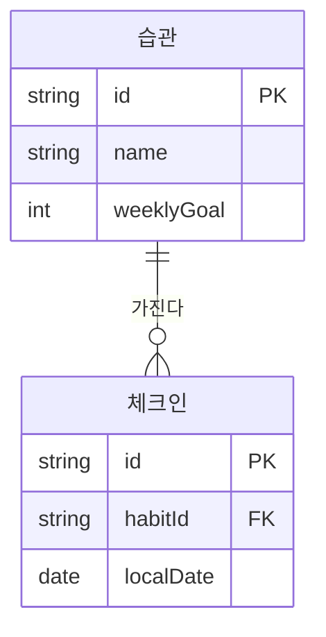

# DEV-35 데이터모델명세서 — 습관·체크인

| 필드 | 값 |
|---|---|
| 상태 | draft |
| 코드 | DEV-35 |
| 마지막 갱신 | 2026-10-13 |
| 범위 | Habit·CheckIn 필드와 관계. DEV-10 |
| 비범위 | HTTP 페이로드(DEV-40), 원격 동기화(DEV-10), 엔진 선정(DEV-50) |
| 관련 문서 | 아래 관련 문서 표 |

## ＊ 개요
로컬 DB에 습관과 날짜별 체크인을 저장한다. 계정 테이블은 DEV-10.

## ＊ 모델
| 엔티티 | 필드 | 형 | 제약 |
|---|---|---|---|
| Habit | id | UUID | PK |
| Habit | name | text | not null |
| Habit | weeklyGoal | int | 1 이상 |
| CheckIn | id | UUID | PK |
| CheckIn | habitId | UUID | FK → Habit.id |
| CheckIn | localDate | date | unique(habitId, localDate). DEV-22 AC-2 |

## ＊ 관계
| 출발 | 도착 | 기수 | 설명 |
|---|---|---|---|
| Habit | CheckIn | 1:N | 한 습관의 날짜별 체크인. CheckIn.habitId가 Habit.id를 가리킨다 |

## ＊ 금지
| 금지 | 이유 |
|---|---|
| 서버 동기화 컬럼·리비전 | DEV-10, DEV-40 |
| 서버로 보낼 개인정보 필드 | DEV-10, DEV-58 |

## ○ 수명·삭제
| 엔티티 | 보관 | 삭제 |
|---|---|---|
| Habit | 앱을 지울 때까지. DEV-10 | 습관 삭제 시 CheckIn을 같이 지울지, soft delete인지는 미결 |
| CheckIn | Habit과 같음 | 해제(DEV-22 AC-3)는 그 날짜 행을 지운다. 습관 삭제 시 동작은 위 미결 |

## 관계도 (Mermaid)

관계도의 `string`은 UUID를 글자로 적는 표기다. 모델 표의 형은 UUID이며, 다른 타입이 하나 더 있는 것이 아니다.

## ○ 관련 문서
| 코드 | 경로 |
|---|---|
| DEV-30 | `DEV-30-구조명세서.HabitCheck.md` |
| DEV-38 | `DEV-38-데이터이전-없음.HabitCheck.md` |
| DEV-50 | `DEV-50-로컬DB-drift.HabitCheck.md` |
| DEV-40 | `DEV-40-없음-v1.HabitCheck.md` |
| DEV-22 | `DEV-22-오늘체크.HabitCheck.md` |
| DEV-10 | `DEV-10-개요서.HabitCheck.md` |
| DEV-58 | `DEV-58-개인정보처리명세서.HabitCheck.md` |
| DEV-65 | `DEV-65-테스트명세서.HabitCheck.md` |
## 미결
| ID | 미결 | 다음에 할 일 |
|---|---|---|
| 1 | 습관 삭제가 CheckIn을 물리 삭제하는지 soft delete인지 모른다 | 정하면 수명 표의 삭제 칸과 DEV-65 시나리오 3의 기대를 같은 문장으로 고친다 |
| 2 | weeklyGoal의 상한이 없다 | 한 주를 넘는 값을 허용할지로 정하면 모델 표의 제약 칸만 고친다. 그 전에 7로 단정하지 않는다 |
