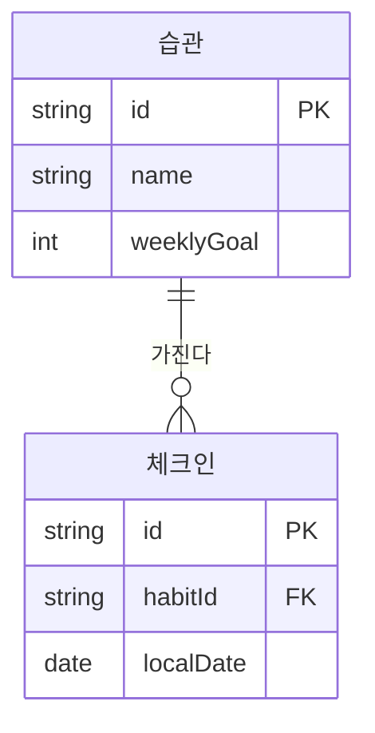

# DEV-35 데이터모델명세서 — 습관·체크인

| 필드 | 값 |
|---|---|
| 상태 | draft |
| 코드 | DEV-35 |
| 마지막 갱신 | 2026-09-01 |
| 범위 | Habit·CheckIn 로컬 모델 |
| 비범위 | API, 원격 동기화 |
| 관련 문서 | 본문 ○ 참고 |

## ＊ 개요
로컬 DB에 습관과 일자별 체크인을 저장한다.

## ＊ 모델
| 엔티티 | 필드 | 형 | 제약 |
|---|---|---|---|
| Habit | id | UUID | PK |
| Habit | name | text | not null |
| Habit | weeklyGoal | int | ≥1 |
| CheckIn | id | UUID | PK |
| CheckIn | habitId | UUID | FK |
| CheckIn | localDate | date | unique(habitId,localDate) |

## ＊ 관계 (Mermaid)

## ○ 수명·삭제
| 엔티티 | 보관 | 삭제 |
|---|---|---|
| 습관 | 로컬 DB | 습관 삭제 시 체크인 cascade (미결: soft delete 여부) |

## ○ 관련 문서
| 코드 | 경로 |
|---|---|
| DEV-30 | 미결 |
| DEV-50 | 미결 |

## ＊ 관계
| 출발 | 도착 | 기수 | 설명 |
|---|---|---|---|
| Habit | CheckIn | 1:N | 습관의 일자별 체크인; CheckIn.habitId 참조 |

## ＊ 금지
| 금지 | 이유 |
|---|---|
| 서버 동기화 가정 | 로컬 전용 v1 |
| 개인정보 서버 적재 | DEV-58 |
## 미결
| ID | 내용 |
|---|---|
| 1 | soft delete |
