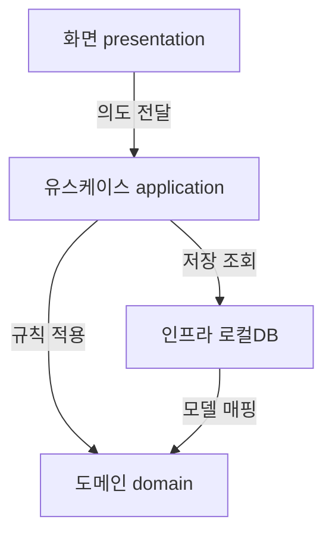
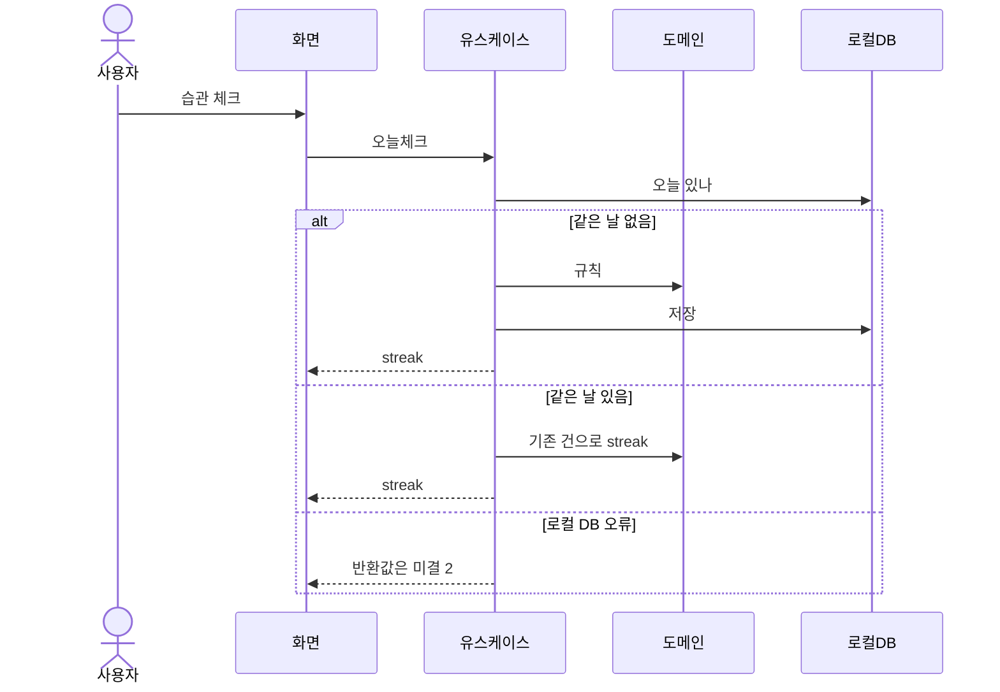

# DEV-30 구조명세서 — HabitCheck

| 필드 | 값 |
|---|---|
| 상태 | draft |
| 코드 | DEV-30 |
| 마지막 갱신 | 2026-10-13 |
| 범위 | 레이어·의존·오늘 체크 흐름 |
| 비범위 | HTTP, 화면 문구, DB 제품 선정 근거 |

## ＊ 한 줄 구조 요약
화면은 유스케이스만 호출하고, 유스케이스가 도메인과 로컬 저장소를 조율하는 단방향 구조다.

## ＊ 모듈/레이어
| 모듈 | 책임 | 비고 |
|---|---|---|
| 화면 presentation | 목록·상세·체크 UI | 유스케이스만 호출 |
| 유스케이스 application | 추가·오늘 체크·streak 조회 | 한 의도당 한 유스케이스 |
| 도메인 domain | Habit·CheckIn, streak, 날짜 경계 | 규칙만 적용 |
| 인프라 infrastructure | 로컬 DB, 마이그레이션, 시계 | 저장·조회와 모델 매핑 |

## ＊ 구조도 (Mermaid)

## ＊ 의존 규칙
| 방향 | 허용? | 설명 |
|---|---|---|
| 화면 → 유스케이스 | 허용 | 화면은 유스케이스만 호출 |
| 유스케이스 → 도메인/인프라 | 허용 | 규칙과 저장·조회 |
| 화면 → DB | 금지 | 화면이 DB를 직접 열지 않는다 |

## ＊ 건드리기 위험 구역
| 모듈 | 이유 | 경로(□) |
|---|---|---|
| 도메인 streak·날짜 | 자정과 타임존이 연속 일수를 바꾼다 | `lib/domain/streak.dart` |
| 인프라 마이그레이션 | 실패하면 기기 안 데이터만 잃는다 | `lib/infrastructure/db/migrations/` |

## ○ 핵심 실행 흐름
| 단계 | 행위자 | 행동 |
|---|---|---|
| 1 | 사용자 | 습관을 체크 |
| 2 | 화면 | 오늘체크(habitId)를 유스케이스에 전달 |
| 3 | 유스케이스 | 오늘 체크인이 없으면 하나 만들고 streak를 계산해 화면에 돌려준다 |
| 4 | 유스케이스 | 같은 날이면 새 행을 만들지 않고 기존 streak를 돌려준다(DEV-22 AC-2) |
| 5 | 유스케이스 | 로컬 DB 오류의 반환 이름은 이 저장소에 없다 |

아래 시퀀스는 위 표의 3단계, 4단계, 5단계와 같은 가지다. 오류 가지의 반환값은 아직 없다.

## ○ 데이터 위치
| 데이터 | 위치 |
|---|---|
| 습관·체크인 | 기기 로컬 DB 한 곳 |
| 화면 상태 | 메모리 |
| 계정·원격 복사본 | v1에는 없다 |

## ○ 관련 문서
| 코드 | 경로 |
|---|---|
| DEV-10 | [DEV-10-개요서.HabitCheck.md](../../_examples/DEV-10-개요서.HabitCheck.md) |
| DEV-22 | [DEV-22-오늘체크.HabitCheck.md](../../_examples/DEV-22-오늘체크.HabitCheck.md) |
| DEV-35 | [DEV-35-습관체크인.HabitCheck.md](../../_examples/DEV-35-습관체크인.HabitCheck.md) |
| DEV-50 | [DEV-50-로컬DB-drift.HabitCheck.md](../../_examples/DEV-50-로컬DB-drift.HabitCheck.md) |
| DEV-65 | [DEV-65-테스트명세서.HabitCheck.md](../../_examples/DEV-65-테스트명세서.HabitCheck.md) |

## 미결
| ID | 내용 |
|---|---|
| 1 | 로컬 DB 구현체는 drift proposed이다. accepted가 되면 인프라 비고에 제품명을 적는다. |
| 2 | 로컬 DB 오류의 반환 이름은 이 저장소에 없다. 이름이 생기면 흐름 5단계와 시퀀스의 실패 가지를 그 이름으로 바꾼다. |
