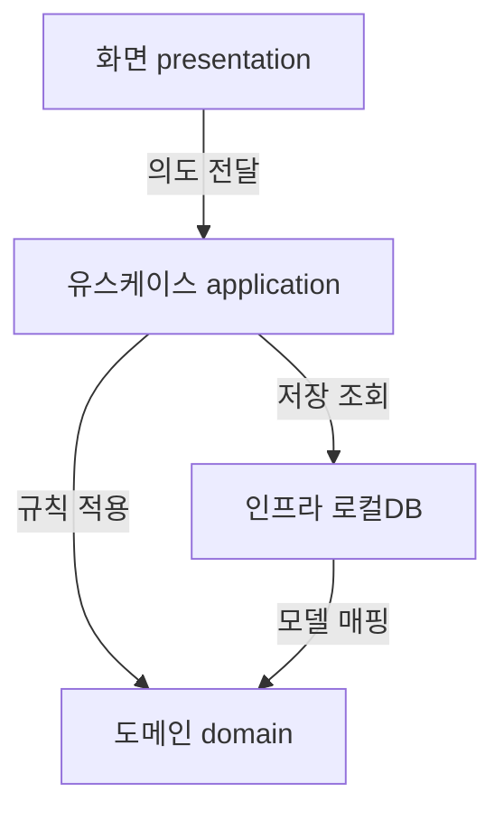
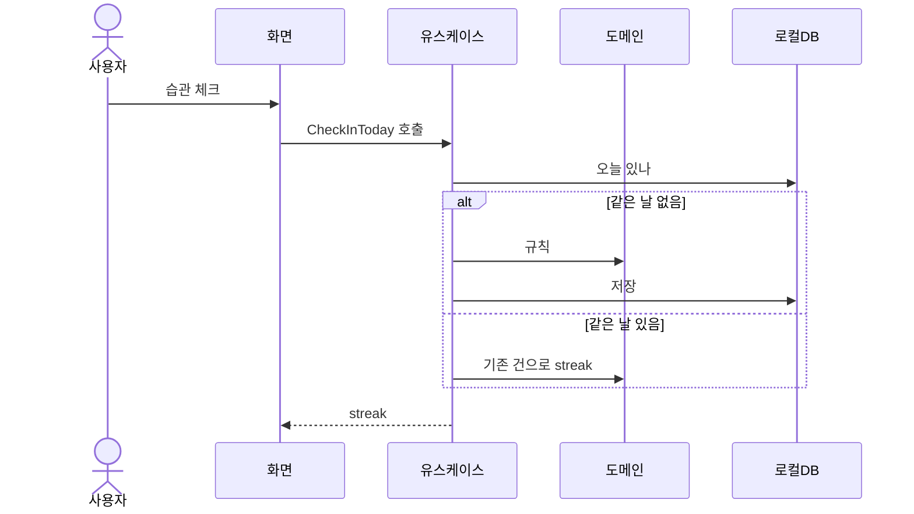

# DEV-30 구조명세서 — HabitCheck

| 필드 | 값 |
|---|---|
| 상태 | draft |
| 코드 | DEV-30 |
| 마지막 갱신 | 2026-10-13 |
| 범위 | 레이어, 의존 방향, 로컬 데이터 위치, 오늘 체크의 호출 순서 |
| 비범위 | HTTP(DEV-40), 화면 문구(DEV-28), 스토어(DEV-85), DB 제품 선정 근거(DEV-50) |
| 관련 문서 | 아래 관련 문서 표 |

## ＊ 한 줄 구조 요약
화면은 유스케이스만 호출하고, 유스케이스가 도메인과 로컬 저장소를 조율하는 단방향 구조다.

## ＊ 모듈/레이어
| 모듈 | 책임 | 비고 |
|---|---|---|
| 화면 presentation | 목록·상세·체크 UI | 유스케이스만 호출 |
| 유스케이스 application | 추가·오늘 체크·streak 조회 | 한 의도당 한 유스케이스. 오늘 체크의 이름은 CheckInToday(habitId)다(DEV-32) |
| 도메인 domain | Habit·CheckIn, streak, 날짜 경계 | 규칙만 적용. 날짜 경계의 값은 HC-MIDNIGHT. 주인은 `DEV-70-구현작업명세서/DEV-70-001-오늘체크-유스케이스.md`다 |
| 인프라 infrastructure | 로컬 DB, 마이그레이션, 시계 | 저장·조회와 모델 매핑. 제품명을 적을지는 HC-DRIFT-STATE. 주인은 `DEV-50-기술결정기록/DEV-50-로컬DB-drift.md`다. 이 칸은 그 문장을 다시 쓰지 않는다 |

## ＊ 구조도 (Mermaid)

## ○ C4 수준
| 수준 | 이 문서에서 | 그리지 않는 것 |
|---|---|---|
| 컴포넌트 | 필수 구조도는 한 앱 안의 화면, 유스케이스, 도메인, 인프라다 | 시스템 맥락의 사용자와 바깥 시스템은 DEV-10. 코드 수준의 클래스는 그리지 않는다 |

## ＊ 의존 규칙
| 방향 | 허용? | 설명 |
|---|---|---|
| 화면 → 유스케이스 | 허용 | 화면은 유스케이스만 호출 |
| 유스케이스 → 도메인 | 허용 | 날짜·streak 규칙은 도메인에 둔다 |
| 유스케이스 → 인프라 | 허용 | 저장과 조회. DEV-32 |
| 인프라 → 도메인 | 허용 | 저장된 행을 도메인 모델로 매핑 |
| 화면 → DB | 금지 | 화면이 DB를 직접 열지 않는다 |
| 도메인 → Flutter UI | 금지 | 도메인이 위젯·플러그인을 부르지 않는다 |

## ＊ 건드리기 위험 구역
| 모듈 | 이유 | 경로(□) |
|---|---|---|
| 도메인 streak·날짜 | 날짜 경계의 값은 HC-MIDNIGHT. 주인은 `DEV-70-구현작업명세서/DEV-70-001-오늘체크-유스케이스.md`다. 이 칸은 그 문장을 다시 쓰지 않는다 | 계획 경로 `lib/domain/streak.dart` |
| 인프라 마이그레이션 | 실패하면 데이터를 잃는다. DEV-10, DEV-38 | 계획 경로 `lib/infrastructure/db/migrations/` |

## ○ 핵심 실행 흐름

streak는 한 습관의 CheckIn.localDate만 센다. 가장 최근 체크인 날짜에서 하루씩 과거로 이어진 개수이고, 하루가 비면 그 앞에서 끊긴다. weeklyGoal은 세지 않는다. 오늘을 해제하면 그 localDate가 빠진다. 남은 체크인이 없으면 0이다. 남아 있으면 가장 최근 남은 날짜에서 다시 센다. 빈 날 없이 이어진 7일 뒤 오늘만 해제하면 가장 최근 날이 어제이므로 6이다.

| 단계 | 행위자 | 행동 |
|---|---|---|
| 1 | 사용자 | 습관을 체크 |
| 2 | 화면 | CheckInToday(habitId)를 유스케이스에 전달한다 |
| 3 | 유스케이스 | 그 habitId와 오늘 localDate 행을 조회한다 |
| 4 | 유스케이스 | 행이 없으면 도메인 규칙으로 체크인을 만들어 저장하고 streak를 계산한다 |
| 5 | 유스케이스 | 행이 있으면 새 행을 만들지 않고 기존 건으로 streak를 계산한다(DEV-22 AC-2) |
| 6 | 유스케이스 | streak를 화면에 돌려준다. 저장 실패의 반환값은 미결 2 |
| 7 | 사용자 | 오늘 체크를 해제 |
| 8 | 화면 | 해제를 유스케이스에 전달한다 |
| 9 | 유스케이스 | 오늘 행을 지운다. 그 뒤의 streak는 이 절 위의 HC-STREAK 문장이다. 이 칸은 그 문장을 다시 쓰지 않는다. 기대 숫자를 표로 펼칠지는 DEV-22 미결 2 |

해제 호출의 함수 이름은 아직 없다. 시퀀스 그림은 단계 1–6의 체크만 그린다. 단계 7–9가 해제다.

## ○ 데이터 위치
| 데이터 | 위치 |
|---|---|
| 습관·체크인 | DEV-10, DEV-35 |
| 화면 상태 | 메모리 |
| 계정·원격 복사본 | DEV-10, DEV-40 |

## ○ 관련 문서
| 코드 | 경로 |
|---|---|
| DEV-10 | `DEV-10-개요서.md` |
| DEV-32 | `../_examples/DEV-32-모듈-application.HabitCheck.md` |
| DEV-35 | `DEV-35-데이터모델명세서/DEV-35-습관체크인.md` |
| DEV-50 | `DEV-50-기술결정기록/DEV-50-로컬DB-drift.md` |
| DEV-22 | `DEV-22-인수조건명세서/DEV-22-오늘체크.md` |
| DEV-70 | `DEV-70-구현작업명세서/DEV-70-001-오늘체크-유스케이스.md` |
| DEV-38 | `../_examples/DEV-38-데이터이전-없음.HabitCheck.md` |
| DEV-40 | `DEV-40-API명세서/DEV-40-없음-v1.md` |
| DEV-28 | `../_examples/DEV-28-UI문구-목록.HabitCheck.md` |
| DEV-85 | `DEV-85-스토어제출명세서/DEV-85-play-내부만.md` |
| DEV-25 | `../_examples/DEV-25-화면정의서-목록.HabitCheck.md` |
| DEV-65 | `../_examples/DEV-65-테스트명세서.HabitCheck.md` |

## 미결
| ID | 내용 |
|---|---|
| 1 | 없는 사실: 로컬 DB 결정 상태는 HC-DRIFT-STATE. 주인은 `DEV-50-기술결정기록/DEV-50-로컬DB-drift.md`다. 다음 행동: 제품명을 비고에 적는 시점은 그 문장을 본다. |
| 2 | 없는 사실: 로컬 DB 오류를 유스케이스가 어떤 값으로 돌려주고 DEV-25 에러 상태가 어떻게 받는지는 없다. 다음 행동: 정하면 흐름 표에 실패 단계를 추가한다. |
