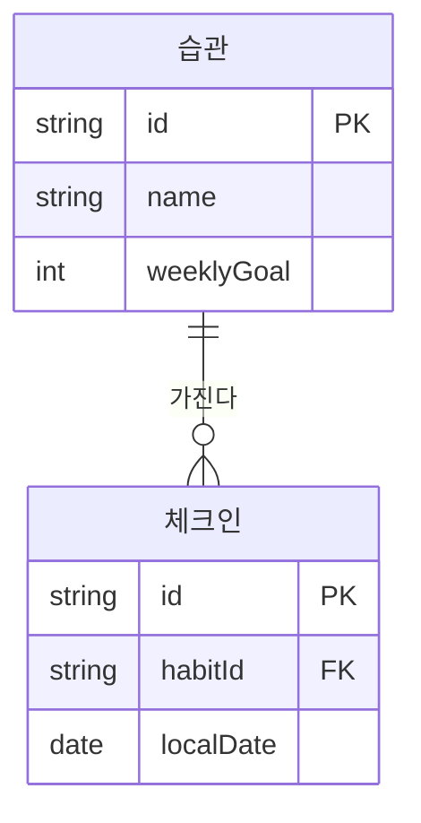

# DEV-35 데이터모델명세서 — 습관·체크인

| 필드 | 값 |
|---|---|
| 상태 | draft |
| 코드 | DEV-35 |
| 마지막 갱신 | 2026-10-13 |
| 범위 | 기기 로컬의 Habit·CheckIn 필드와 관계 |
| 비범위 | HTTP 페이로드(DEV-40), 원격 동기화, 엔진 선정(DEV-50) |
| 관련 문서 | 아래 관련 문서 표 |

## ＊ 개요
로컬 DB에 습관(Habit)과 날짜별 체크인(CheckIn)만 저장한다. 계정 테이블은 없다. 읽는 순서는 필드 표, 관계, 금지, 수명, 관계도, 미결이다. localDate는 시각이 없는 달력 날짜다. 그 날짜를 고르는 경계는 컬럼이 아니다. 값은 HC-MIDNIGHT. 주인은 `../DEV-70-구현작업명세서/DEV-70-001-오늘체크-유스케이스.md`다. 지금 숫자로 확정된 제약은 PK, name not null, weeklyGoal 1 이상, unique(habitId, localDate)뿐이다.

## ＊ 모델
| 엔티티 | 필드 | 형 | 제약 |
|---|---|---|---|
| Habit | id | UUID | PK. UUID를 누가 만드는지는 미결 4 |
| Habit | name | text | not null. 빈 문자열과 최대 길이는 미결 2 |
| Habit | weeklyGoal | int | 1 이상. 상한은 미결 3. weeklyGoal이 streak에 들어가는지는 HC-STREAK. 주인은 `../DEV-30-구조명세서.md`다. 이 칸은 그 문장을 다시 쓰지 않는다 |
| CheckIn | id | UUID | PK. 생성 주체는 미결 4 |
| CheckIn | habitId | UUID | FK → Habit.id. ON DELETE는 미결 1이 닫힌 뒤에 적는다 |
| CheckIn | localDate | date | unique(habitId, localDate). DEV-22 AC-2의 같은 날 1건 |

## ＊ 관계
| 출발 | 도착 | 기수 | 설명 |
|---|---|---|---|
| Habit | CheckIn | 1:N | 한 습관의 날짜별 체크인. CheckIn.habitId가 Habit.id를 가리킨다 |

## ＊ 금지
| 금지 | 이유 |
|---|---|
| 서버 동기화 컬럼·리비전 | v1은 로컬 전용이다(DEV-10, DEV-40) |
| 서버로 보낼 개인정보 필드 | 서버 수집이 없다. 기기 안에 남는 항목은 DEV-58의 수집 행이다 |

## ○ 수명·삭제
| 엔티티 | 보관 | 삭제 |
|---|---|---|
| Habit | 앱을 지울 때까지 기기 로컬 | 습관 삭제 시 CheckIn을 같이 지울지, soft delete인지는 미결 1 |
| CheckIn | Habit과 같음 | 오늘 체크인만 있을 때의 해제(DEV-22 AC-3)는 그 날짜 행을 지운다. streak 값은 HC-STREAK. 주인은 `../DEV-30-구조명세서.md`다. 습관 삭제 시 동작은 미결 1 |

## 관계도 (Mermaid)

그림의 습관은 표의 Habit이고, 체크인은 표의 CheckIn이다. 이름 길이, weeklyGoal 상한, UUID 생성 주체는 미결 2–4이고, 그림은 그 값을 정하지 않는다.

## ○ 관련 문서
| 코드 | 경로 |
|---|---|
| DEV-30 | `../DEV-30-구조명세서.md` |
| DEV-38 | `../../_examples/DEV-38-데이터이전-없음.HabitCheck.md` |
| DEV-50 | `../DEV-50-기술결정기록/DEV-50-로컬DB-drift.md` |
| DEV-40 | `../DEV-40-API명세서/DEV-40-없음-v1.md` |
| DEV-22 | `../DEV-22-인수조건명세서/DEV-22-오늘체크.md` |
| DEV-10 | `../DEV-10-개요서.md` |
| DEV-20 | `../DEV-20-요구사항명세서.md` |
| DEV-58 | `../../_examples/DEV-58-개인정보처리명세서.HabitCheck.md` |
| DEV-65 | `../../_examples/DEV-65-테스트명세서.HabitCheck.md` |
| DEV-70 | `../DEV-70-구현작업명세서/DEV-70-001-오늘체크-유스케이스.md` |

## 미결
| ID | 미결 | 다음에 할 일 |
|---|---|---|
| 1 | 습관 삭제가 CheckIn을 물리 삭제하는지 soft delete인지 모른다 | 정하면 수명 표의 삭제 칸, habitId의 ON DELETE, DEV-65 습관 삭제 행의 기대를 같은 문장으로 고친다 |
| 2 | Habit.name의 빈 문자열 허용과 최대 길이가 없다 | 정해지면 모델 표 name의 제약 칸만 고친다. 길이는 확인 전에 숫자로 채우지 않는다 |
| 3 | weeklyGoal의 상한이 없다 | 정해지면 모델 표 weeklyGoal의 제약 칸만 고친다. 상한은 확인 전에 숫자로 채우지 않는다 |
| 4 | Habit.id와 CheckIn.id의 UUID를 누가 만드는지 모른다 | 정해지면 두 id 행의 제약 칸에 생성 주체만 적는다 |
